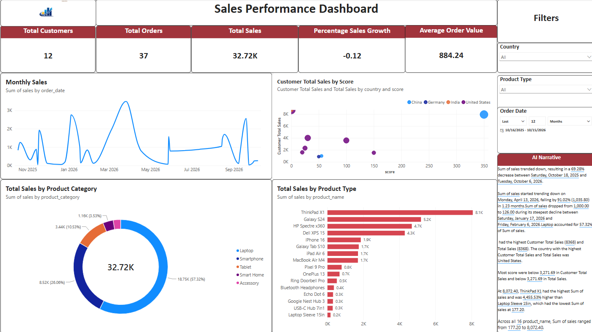
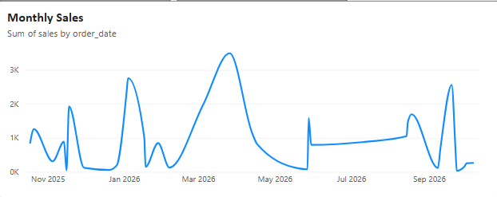
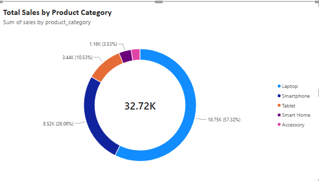
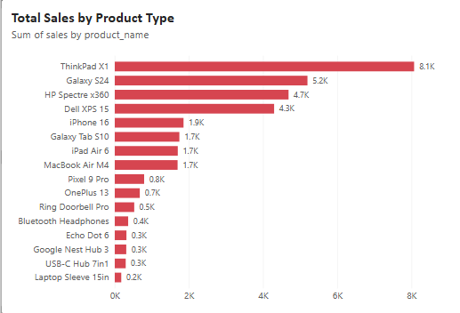
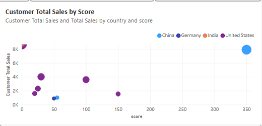
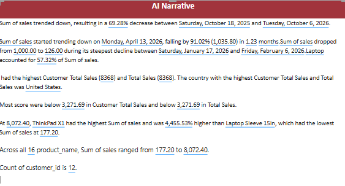

# 📊 Sales Performance Dashboard — Power BI

A complete Power BI dashboard analyzing sales performance, customer behavior, product trends, and category insights.  
This project demonstrates data modeling, DAX calculations, interactive visuals, and AI-generated narrative insights.

---

## 🚀 Features
- Total Customers, Orders, Sales, Growth %, AOV  
- Monthly Sales Trend (Line Chart)  
- Customer Score vs Total Sales (Scatter Plot)  
- Category Sales Breakdown (Donut Chart)  
- Product-Level Sales (Bar Chart)  
- AI Narrative Insights (Auto-generated)  
- Interactive Filters (Country, Product Type, Date)

---

## 🖼️ Dashboard Preview

### Overview


### Monthly Sales


### Category Sales


### Product Sales


### Customer Score Analysis


### AI Narrative


---

## 🔗 Live Dashboard
👉 https://app.powerbi.com/links/KSnnxoNtrJ?ctid=817e42a6-b2ff-4e02-82a9-c4afd51e044d&pbi_source=linkShare

---

## 🧠 Key Insights
- Sales trended down over the last 12 months.  
- Laptops contributed **57.32%** of total sales.  
- ThinkPad X1 is the top-performing product (8.1K).  
- The United States leads in customer total sales.  
- Customer scores vary significantly across countries.

---

## 🧮 DAX Measures Used
```DAX
Total Sales = SUM(Orders[Sales])
Total Orders = COUNTROWS(Orders)
Average Order Value = DIVIDE([Total Sales], [Total Orders])
Customer Total Sales = SUMX(RELATEDTABLE(Orders), Orders[Sales])
